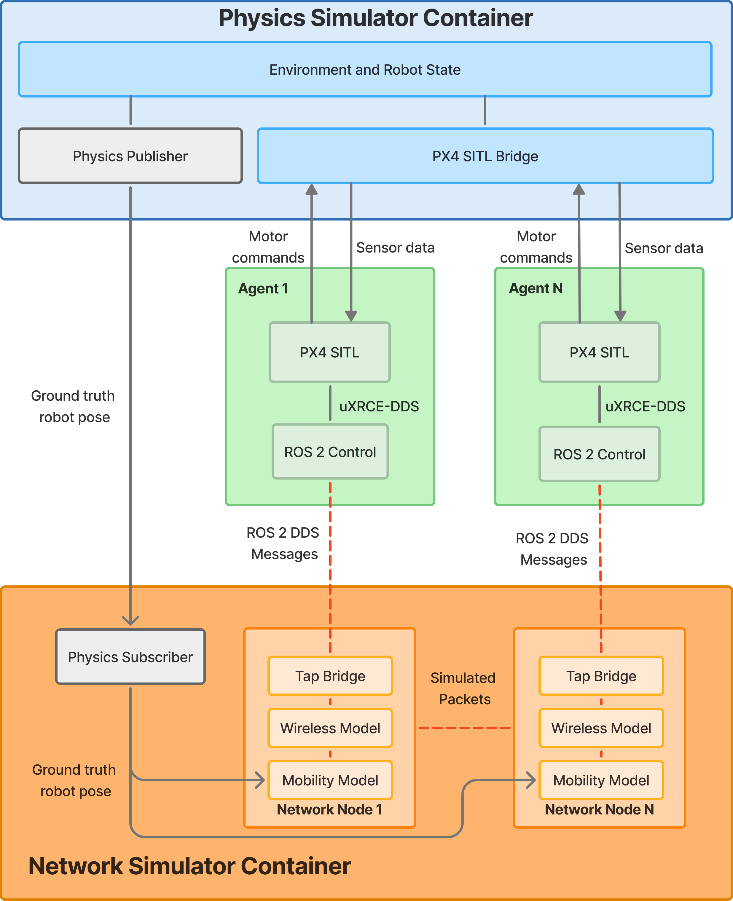

# Architecture

How the cosimulator couples a physics simulator, per-robot software stacks and an ns-3 wireless channel, and which
modelling assumptions each part makes.



*Conceptual architecture. The physics simulator exchanges sensor data and motor commands with each agent's PX4 SITL and
publishes ground-truth poses. The poses drive each agent's position in the network simulator. ROS 2 traffic between
agents crosses the network simulator's wireless model through a TapBridge.*

## Contents

- [Overview](#overview)
- [Deployments](#deployments)
- [Components](#components)
- [Wireless emulation path](#wireless-emulation-path)
- [Position feed](#position-feed)
- [Management network](#management-network)
- [Software inside each robot](#software-inside-each-robot)
- [Swarm protocol](#swarm-protocol)
- [Run validity](#run-validity)
- [Limitations](#limitations)

## Overview

The cosimulator couples three independent parts:

1. A **physics simulator** (Gazebo Harmonic) provides vehicle dynamics and ground-truth poses.
2. A **per-robot software stack** (PX4 SITL and ROS 2 nodes) runs in its own Linux network namespace or container.
3. A **wireless channel emulator** (ns-3 3.48) carries all robot-to-robot traffic.

Packets from real ROS 2 processes cross a simulated Wi-Fi channel. The physics simulator supplies only positions.
Robots have no network path to each other except through ns-3; the isolation tests in [EXPERIMENTS.md](EXPERIMENTS.md)
check this.

## Deployments

The same experiment YAML, ns-3 scenario, agent software and analysis run in two deployments:

| Item | Native | Docker Compose |
|---|---|---|
| Agent isolation | One network namespace per agent (`orchestrator/wire.py`) | One container per agent (`orchestrator/container_net.py`) |
| ns-3 | Host process | `ns3` container |
| Physics simulator | Host process | `simulator` container |
| Needs on the host | ROS 2, Gazebo, PX4 runtime, ns-3 build, root or user namespaces | Docker |
| Example command | `tests/leader_follower_fly.sh` | `tests/containers_leader_follower.sh` |

The emulation path, DDS domains, swarm protocol and validity checks below are identical in both.
[CONTAINERS.md](CONTAINERS.md) describes the Docker deployment.

## Components

| Component | Location | Role |
|---|---|---|
| ns-3 scenario | `ns3/scenarios/wifi_adhoc_tap` | One ghost node per robot on a shared 802.11 channel, one TapBridge per node |
| Network wiring | `orchestrator/wire.py` | Namespaces, TAP devices, bridges, management network, radio firewall |
| Stack launcher | `orchestrator/run_stack.py` | Starts Gazebo, then an XRCE-DDS agent and a PX4 SITL instance per robot |
| Fleet roles | `orchestrator/fleet.py` | Resolves leader, followers, formation offsets and topic QoS from the YAML |
| Pose bridge | `adapters/gazebo/pose_bridge.py` | Streams Gazebo poses and the real-time factor to ns-3 |
| Swarm node | `ros2_ws/src/swarm_control` | Leader-follower radio node: the leader publishes, followers subscribe |
| Mesh node | `ros2_ws/src/mesh_control` | Mesh-dropout radio node: all-to-all heartbeat |
| Flight nodes | `ros2_ws/src/px4_offboard_control` | Offboard control of PX4 on the local domain |
| Messages | `ros2_ws/src/swarm_msgs`, `ros2_ws/src/mesh_msgs` | `LeaderState`, `PeerState` |

## Wireless emulation path

Each robot has a network interface `radio0`. Frames take this path:

```text
radio0 -> veth -> Linux bridge -> TAP -> ns-3 TapBridge -> ghost node -> shared 802.11 channel
```

| Property | Description |
|---|---|
| Real-time emulation | ns-3 runs its real-time simulator with TapBridge in `UseLocal` mode, so unmodified software exchanges real packets. |
| Ghost nodes | A ghost node has no IP stack. IP addresses live on `radio0`, and the node's Wi-Fi device adopts the MAC address of `radio0`. |
| Source-MAC guard | An nftables bridge rule on each TAP drops frames whose source MAC is not that robot's `radio0`. |
| IPv6 | Disabled on the emulated interface chain, to keep neighbour-discovery traffic off the channel. |
| Local ns-3 patch | Fixes a crash in ns-3 3.48 when TapBridge sets a Wi-Fi device's MAC address. See [../ns3/patches/README.md](../ns3/patches/README.md). |

The source-MAC guard is required. Without it, TapBridge reads the kernel's own bridge traffic (for example IGMP) first,
and the ghost device adopts the wrong MAC. Unicast frames are then missed and retransmitted.

The default channel model is 802.11a at a constant OFDM rate of 12 Mbit/s (control frames 6 Mbit/s), 16 dBm transmit
power, log-distance path loss with exponent 3.0 and constant-speed propagation delay. The receiver parameters and the
error-rate model are explicit in the YAML and decide which mechanism limits the range. See
[CONFIGURATION.md](CONFIGURATION.md) and [SIGNAL_MODEL.md](SIGNAL_MODEL.md).

## Position feed

`adapters/gazebo/pose_bridge.py` maps Gazebo models to agents, adds each agent's antenna offset and sends one UDP/JSON
datagram at a fixed rate (default 50 Hz). The datagram holds a sequence number, simulation time, wall time and the
positions. The bridge repeats the last pose when nothing changes.

A listener thread in ns-3 parses each datagram and schedules the position update on the simulator thread. Only the
simulator thread touches ns-3 objects; the listener passes plain integers.

Modelling choices:

- Only position is applied. Each ghost node has a constant-position mobility model that is updated at the feed rate.
- Before the first pose arrives, and in tests without a simulator, each node sits at its configured start position.
  See [CONFIGURATION.md](CONFIGURATION.md).

## Management network

The simulator, the pose bridge and ns-3 share a management network (`br-mgmt`, 10.20.0.0/24 by default). Each robot
has an `eth0` on an isolated bridge port, so robots reach the simulator but not each other. PX4 reaches Gazebo over
gz-transport on this network. This traffic is not emulated.

## Software inside each robot

A robot runs a PX4 SITL instance, a Micro XRCE-DDS agent, a flight node and a radio node. Two DDS domains with disjoint
reach separate local control from inter-robot traffic:

| Domain | Reach | Carries |
|---|---|---|
| 0 | Localhost only (`ROS_AUTOMATIC_DISCOVERY_RANGE=LOCALHOST`) | PX4 topics (`/fmu/...`) and the follower target |
| 42 | Bound to `radio0` | The swarm message only |

The radio node is one process with two ROS 2 contexts, one per domain, connected by function calls.

A default-deny nftables policy on `radio0` allows only the UDP ports of domain 42. It exists because the XRCE agent
otherwise advertises PX4 topics on every interface. Counters report blocked attempts. The isolation checks confirm that
no domain-0, XRCE or PX4-topic traffic appears on the emulated channel.

PX4 instance *N* publishes under `/px4_N/fmu/...` and uses MAVLink system id *N* + 1. Instance 0 has no prefix.

## Swarm protocol

This section describes the default scenario, leader-follower. The second scenario, mesh dropout, runs an all-to-all
heartbeat (`mesh_msgs/PeerState` on `/mesh/peer_state`) on the same domain and firewall. See
[MESH_DROPOUT.md](MESH_DROPOUT.md).

The only inter-robot message is `swarm_msgs/LeaderState`: sender id, per-sender sequence number, send timestamp, and
position and velocity in a shared world frame (ENU, metres). Sequence numbers and timestamps give loss and latency
without extra instrumentation.

The default QoS is best-effort, volatile, keep-last 1, so loss stays visible instead of being hidden by
retransmission. `swarm.qos.leader_state` changes it. See [CONFIGURATION.md](CONFIGURATION.md).

| Role | Behaviour |
|---|---|
| Leader | Reads its PX4 state on the local domain, converts it to the world frame and publishes at a fixed rate. |
| Follower | Computes `target = leader position + offset` and publishes it locally on `/swarm/follower_target`. |
| Follower | Logs per-message latency and sequence gaps to a CSV, and reports link loss after a configurable silence. |
| Follower flight node | Flies to the target at a fixed altitude. On link loss it holds the last target (`hold`) or lands (`land`). |

PX4's local frame is NED with its origin at the vehicle's start. The conversion to the world ENU frame uses the spawn
pose and assumes the ground is at z = 0.

## Run validity

The emulation is real-time, so a run is meaningful only if the simulators keep up. Each run reports two checks:

| Check | Definition | Limit |
|---|---|---|
| ns-3 lag | Wall-clock time minus simulated time | At most `time.max_lag_ms` |
| Real-time factor | Simulated time advanced per wall-clock second, as a sliding mean over `time.rtf_window_s` | At least `time.min_rtf` |

The real-time factor matters because the emulated radio runs on the wall clock. A simulator that falls behind feeds
ns-3 positions that are late relative to the traffic.

The measured window for the real-time factor starts at the `go` signal (take-off) when a run has one, otherwise 5 s
after the first applied pose. It ends with the last pose. Single-sample dips are reported and are not fatal. Stalls
before take-off are printed as a `note` and are not part of the criterion.

| Date | Criterion change | Reason |
|---|---|---|
| 2026-10-21 | The window starts at take-off instead of at the first pose. `time.min_rtf` is unchanged. | A Gazebo GUI attaching on the ground caused a 0.4 s stall at a factor of 0.04 and failed the earlier definition. |

## Limitations

- The flight-control DDS path of each robot uses the address of `radio0`, delivered over loopback. It fails if ns-3
  stops and `radio0` loses carrier. Separate vehicle and radio namespaces would remove the dependency; this is not
  implemented.
- The follower's link-loss behaviour is configurable (`hold` or `land`). No policy is recommended.
- The leader-follower scenario has one leader per experiment. Followers only receive.
- Ghost nodes have no IP stack, so the radio is single hop. Multi-hop routing is not implemented.
- The validity check sets a lower bound on the real-time factor only. A simulator that runs faster than real time is
  not detected.
- The ground is assumed at z = 0 in the altitude conversion.
- The native deployment supports Gazebo with the x500 multirotor. Ground vehicles and the experimental Isaac Sim driver
  are available in the Docker deployment only. See [CONTAINERS.md](CONTAINERS.md).
