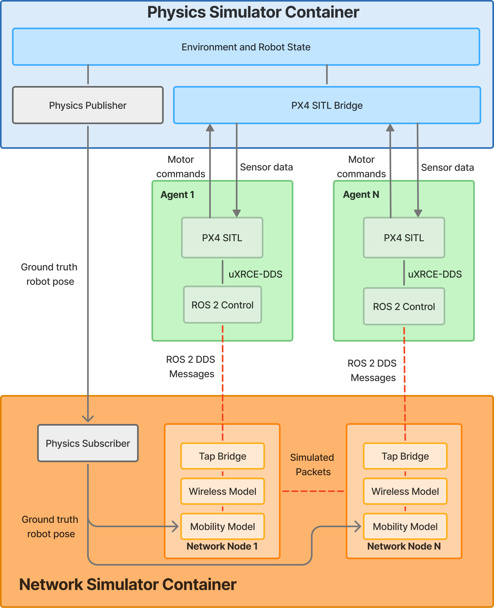

# Architecture



*Conceptual architecture. The physics simulator provides each agent's PX4 SITL with sensor data and receives motor commands, and publishes
ground-truth poses that drive each agent's mobility model in the network simulator. ROS 2 traffic between agents is carried by the network
simulator's wireless model through a TapBridge. Two deployments implement it: the native one, where the "containers" are host processes in per-agent Linux network
namespaces, and the Docker one, where they are real containers ([CONTAINERS.md](CONTAINERS.md)). The ROS 2 control layer is split as described below.*

## Overview

The cosimulator couples three independent parts:

1. **A physics simulator** (Gazebo Harmonic) that provides vehicle dynamics and ground-truth poses.
2. **Per-robot software stacks** (PX4 SITL, ROS 2 nodes), each in its own Linux network namespace.
3. **A wireless channel emulator** (ns-3, 802.11a) through which all robot-to-robot traffic passes.

Packets from real ROS 2 processes cross a simulated Wi-Fi channel; the simulator only supplies positions. Robots have
no network path to each other other than through ns-3. This is checked by the isolation tests (see [EXPERIMENTS.md](EXPERIMENTS.md)).

## Deployments

The same experiment YAML, ns-3 scenario, agent software and tests run two ways:

| | Native | Docker Compose |
|---|---|---|
| Agent isolation | Linux network namespace per agent (`orchestrator/wire.py`) | One container per agent, private link network to ns-3 (`orchestrator/container_net.py`) |
| ns-3 | Host process | `ns3` container |
| Physics simulator | Host process | `simulator` container |
| Needs on the host | ROS 2, Gazebo, PX4 runtime, ns-3 build, root or user namespaces | Docker only |
| Run with | `tests/leader_follower_fly.sh` | `tests/containers_leader_follower.sh` |

The wireless emulation path, DDS domains, swarm protocol and run-validity checks below are identical in both.

## Components

| Component | Location | Role |
|---|---|---|
| ns-3 scenario | `ns3/scenarios/wifi_adhoc_tap` | One *ghost node* per robot on a shared 802.11 channel; one TapBridge per ghost node; applies robot positions from the pose feed |
| Network wiring | `orchestrator/wire.py` | Creates per-robot namespaces, TAP devices, bridges, veth pairs, the management network and the radio firewall |
| Stack launcher | `orchestrator/run_stack.py` | Starts Gazebo, then a XRCE-DDS agent and a PX4 SITL instance per robot inside its namespace |
| Fleet roles | `orchestrator/fleet.py` | Resolves leader, followers and formation offsets from the experiment YAML |
| Pose bridge | `adapters/gazebo/pose_bridge.py` | Streams Gazebo poses (and real-time factor) to ns-3 |
| Swarm node | `ros2_ws/src/swarm_control` | The only node that talks over the radio; leader publishes, followers subscribe |
| Flight nodes | `ros2_ws/src/px4_offboard_control` | Offboard control of PX4 (trajectories, follower tracking); local only |
| Message definition | `ros2_ws/src/swarm_msgs` | `LeaderState` |

## Wireless emulation path

Each robot has a network interface `radio0` inside its namespace. Frames take this path:

```
radio0 -> veth -> Linux bridge -> TAP -> ns-3 TapBridge -> ghost node -> shared 802.11a channel
```

- **Real-time emulation.** ns-3 runs with its real-time simulator and TapBridge (`UseLocal` mode), so unmodified
  software exchanges real packets. ns-3 version 3.48 is pinned.
- **Ghost nodes carry no IP stack.** IP addresses live on the Linux side (`radio0`). The ghost node's
  Wi-Fi device adopts the MAC address of `radio0`.
- **Source-MAC guard.** An nftables bridge rule on each TAP drops frames whose source MAC is not that robot's `radio0`.
  Without it the kernel's own bridge traffic (e.g. IGMP) is read first by TapBridge and the ghost device adopts the wrong
  MAC, which causes unicast frames to be missed and retransmitted.
- **IPv6 is disabled** on the emulated interface chain to keep neighbour-discovery traffic off the channel.
- **Channel model.** Default: 802.11a, constant-rate OFDM 12 Mbit/s (control 6 Mbit/s), 16 dBm transmit power,
  log-distance path loss (exponent 3.0), constant-speed propagation delay. Receiver parameters (noise figure, preamble
  detection RSSI and SNR floors, CCA-ED threshold, sensitivity) and the error-rate model are explicit in the YAML.
  They decide which mechanism limits the range; see [CONFIGURATION.md](CONFIGURATION.md).
- **Local ns-3 patch.** `ns3/patches/0001-wifi-mac-sync-link-address-on-SetAddress.patch` fixes a crash in
  ns-3 3.48 when TapBridge sets a Wi-Fi device's MAC address. See `ns3/patches/README.md`.

## Position feed

Gazebo publishes model poses; `pose_bridge.py` maps Gazebo models to agents, adds the per-agent antenna offset and sends
a UDP/JSON datagram (sequence number, simulation time, wall time, positions) at a fixed rate (default 50 Hz), repeating the last pose
when nothing changed. A listener thread in ns-3 parses each datagram and schedules the position update on the simulator
thread. Only position is applied (constant-position mobility models). ns-3 objects are only touched on the simulator thread;
the listener passes plain integers.

Before the first pose arrives, and in tests without a simulator, each ghost node sits at its configured start position
(see [CONFIGURATION.md](CONFIGURATION.md)).

## Management network

The simulator, pose bridge and ns-3 live in the root namespace on a bridge (`br-mgmt`, 10.20.0.0/24). Each robot has an `eth0`
on an isolated bridge port: robots reach the simulator but not each other. PX4 reaches Gazebo over gz-transport on this
network. This traffic is not emulated.

## Software inside each robot

A robot runs, inside its namespace: a PX4 SITL instance (x500 quadrotor), a Micro XRCE-DDS agent, a flight node and a swarm node.
Two DDS domains with disjoint reach separate local control from inter-robot traffic:

| Domain | Scope | Carries |
|---|---|---|
| 0 | Localhost only (`ROS_AUTOMATIC_DISCOVERY_RANGE=LOCALHOST`) | PX4 topics (`/fmu/...`), the follower target |
| 42 | Bound to `radio0` | The swarm message only |

The swarm node is one process with two ROS 2 contexts, one per domain, connected by function calls. A default-deny
nftables policy on `radio0` allows only the UDP ports of domain 42 (the XRCE agent otherwise advertises PX4 topics on every
interface). Counters report any blocked attempts. The isolation checks confirm that no domain-0, XRCE or PX4-topic
traffic appears on the emulated channel.

PX4 instance *N* publishes under `/px4_N/fmu/...` (instance 0 has no prefix) and uses MAVLink system id *N*+1.

## Swarm protocol

The only inter-robot message is `swarm_msgs/LeaderState`: sender id, per-sender sequence number, send timestamp, position and
velocity in a shared world frame (ENU, metres). It uses best-effort, keep-last-1 QoS, so loss is visible rather than hidden
by retransmission. Sequence numbers and timestamps give loss and latency without extra instrumentation.

- **Leader:** reads its PX4 state on the local domain, converts it to the world frame and publishes at a fixed rate.
- **Follower:** computes `target = leader position + offset`, publishes it on the local domain (`/swarm/follower_target`) and
  logs per-message latency and sequence gaps to a CSV. It reports link loss after a configurable silence.
- **Follower flight node:** flies to the target at a fixed altitude. On link loss it holds the last target (`hold`) or lands (`land`).

PX4's local frame is NED with its origin at the vehicle's start; the conversion to world ENU uses the spawn pose and
assumes the ground is at z = 0.

## Run validity

Because the emulation is real-time, a run is only meaningful if the simulators keep up. Each run reports:
- **ns-3 lag** (wall clock minus simulated time) against `time.max_lag_ms`.
- **Gazebo real-time factor**, as a sliding mean over `time.rtf_window_s` against `time.min_rtf`. Single-sample dips are reported but not fatal.

## Limitations

- The flight-control DDS path of each robot currently uses `radio0`'s address (delivered over loopback), so it fails if ns-3 stops and `radio0` loses carrier. Separating the vehicle and radio namespaces would remove the dependency.
- The follower's link-loss behaviour is configurable (`hold` or `land`); no policy is recommended yet.
- One leader per experiment; followers only receive.
- Quadrotor (PX4 x500) in Gazebo only. A second simulator adapter requires a pose bridge and a vehicle driver.
- The native deployment runs robots in plain network namespaces; the container deployment is described in [CONTAINERS.md](CONTAINERS.md) (headless, Gazebo only).
- Ground is assumed at z = 0 in the swarm node's altitude conversion.
